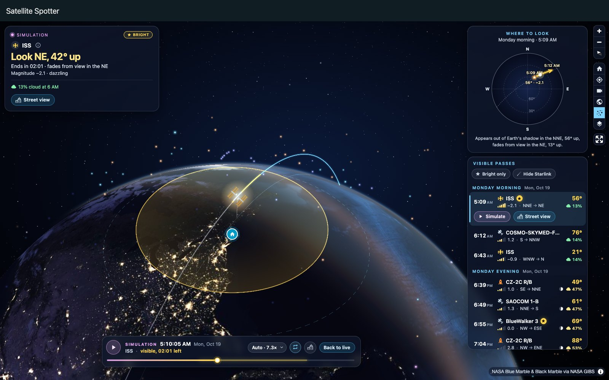
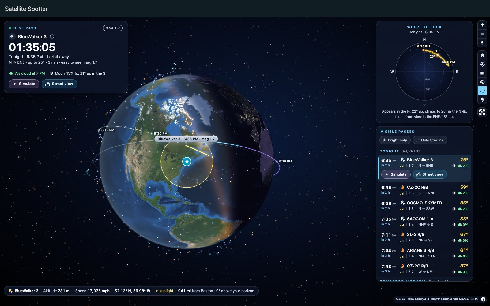
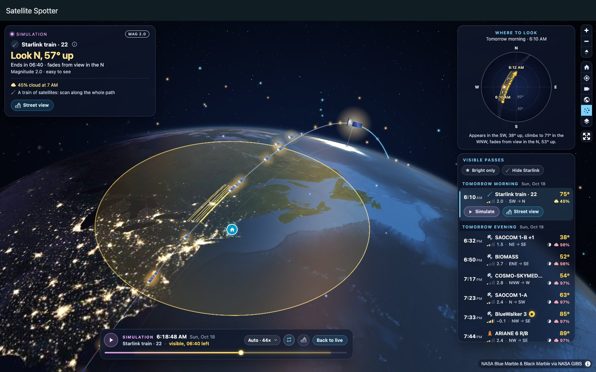
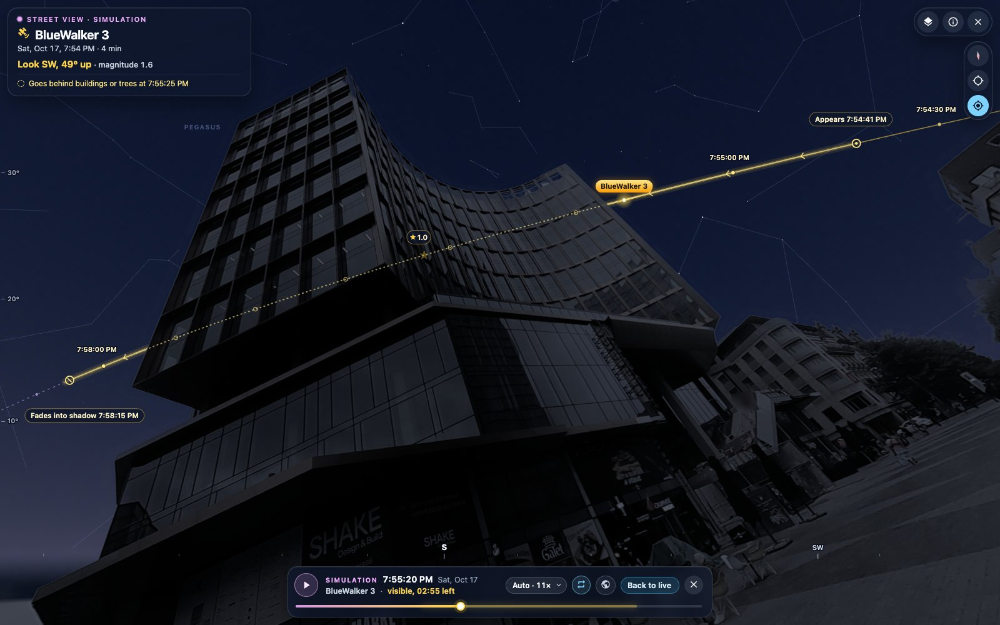
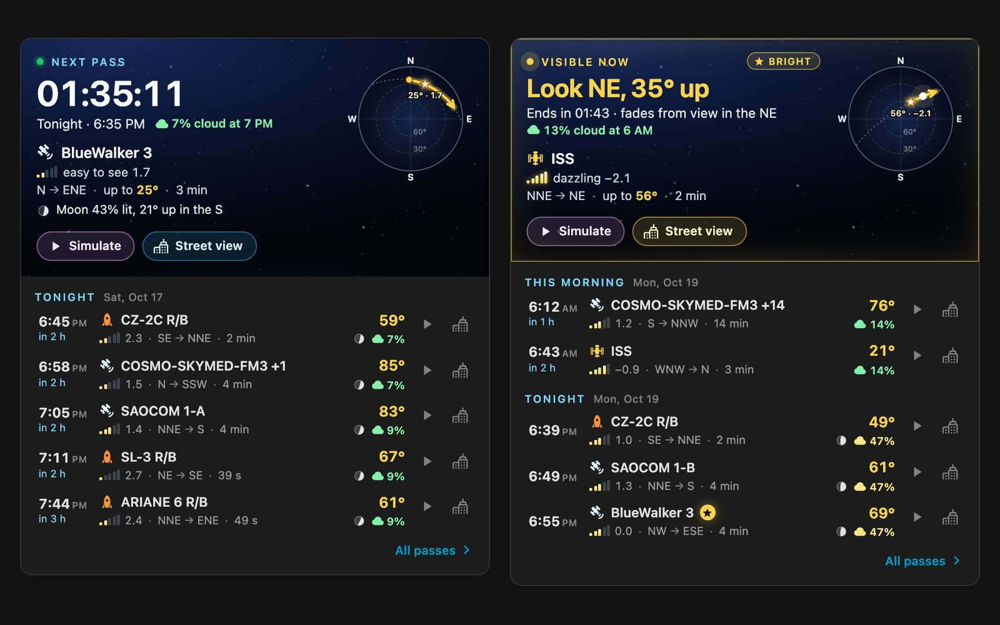
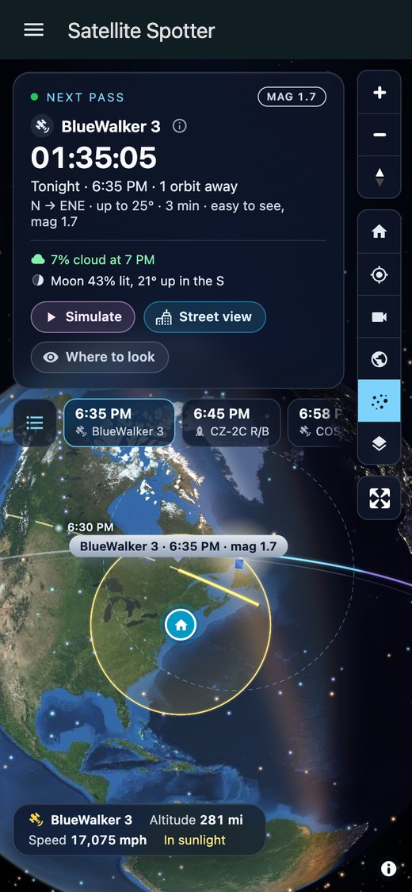
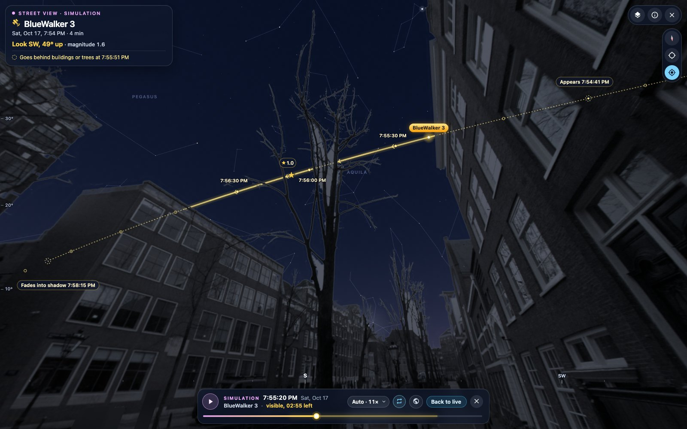
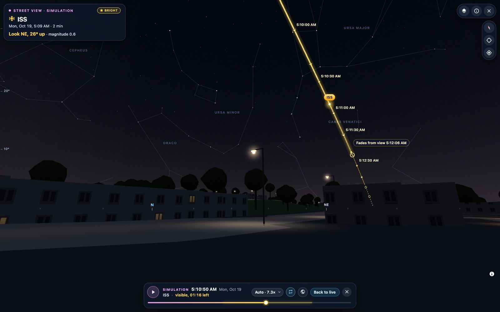
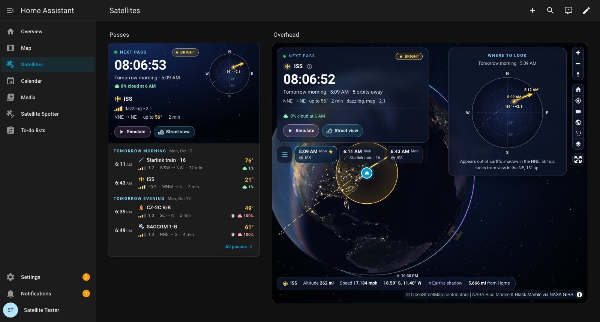

# Satellite Spotter for Home Assistant

[](https://hacs.xyz/docs/faq/custom_repositories/)
[](https://github.com/kedube/ha-satellite-spotter/releases)
[](https://github.com/kedube/ha-satellite-spotter/actions/workflows/ci.yml)

[](LICENSE)



Know when to step outside and look up. This custom integration predicts when satellites
will be **visible to the naked eye** from your home: every bright satellite in James
Darpinian's catalogue, about 890 of them, from the International Space Station, China's
Tiangong and Hubble to trains of Starlink satellites and spent rocket stages. For each pass
it tells you when and where to look, how high the satellite climbs and how bright it will
be. The **Satellite Spotter** page then shows you the pass: on a 3D globe, flying its real
orbit, and from your own street, in a photo of it or among the buildings around you in
3D, under the stars it will cross.

The predictions are those of James Darpinian's
[See A Satellite Tonight](https://james.darpinian.com/satellites/): his catalogue of the
satellites worth looking for, and his model of how bright each one looks and when your sky
is dark enough to see it. Willem Vooijs ported them to Python, with James's permission, as
the see-a-satellite library. Satellite Spotter runs its fork,
[pysatellitespotter](https://github.com/kedube/pysatellitespotter), on your Home
Assistant, so you get the website's passes, worked out locally. Nothing about where you are
goes to the website; only the optional cloud forecast and the maps and street photos your
browser loads see your area (see
[Data sources, privacy and etiquette](#data-sources-privacy-and-etiquette)).

[How it works](#how-it-works) · [Installation](#installation) · [Setup](#setup) ·
[Entities](#entities) · [The page](#the-satellite-spotter-page) ·
[Street view](#street-view) · [Cards](#dashboard-cards) · [Notifications](#notifications)
· [Calendar](#calendar) · [Privacy](#data-sources-privacy-and-etiquette) ·
[Troubleshooting](#troubleshooting) · [Development](#development) ·
[Credits](#credits-and-licence)

## What you get

* **The passes worth stepping outside for**, five days ahead, for each of your locations:
  when, where to look, how high, how bright and how cloudy. Satellites that cross the sky
  together count as one pass, and a string of Starlinks is a train.
* **Sensors and a calendar** for automations, with the same entity ids, attributes and
  calendar text as the
  [See A Satellite Tonight integration](https://github.com/wildekek/ha-see-a-satellite),
  plus a **Bright pass soon** sensor.
* **A notification blueprint**: your phone tells you where to look a few minutes before a
  bright pass, and opens the pass in the street view when you tap it.
* **The Satellite Spotter page**: a 3D globe with day, night and city lights; each pass
  simulated along its real orbit, with the part you can see in gold; a sky chart of where
  to look; the list of passes; and every satellite of the catalogue in orbit around the
  Earth.
* **Street view**: the pass from your street, in a 360° photo taken there and darkened for
  the night (from Panoramax, or from Mapillary and Google Street View with their keys), or
  in a 3D model of the buildings, trees, street lights and hills around you, under the
  stars, Moon and planets of that moment. The satellite's path is drawn across your sky and
  hidden where a building or a tree would hide it.
* **Two dashboard cards**: the globe, and a passes card with a countdown and a sky chart
  that needs no 3D, for wall tablets and old phones.
* **Several locations** (home, a cabin, a dark-sky site) sharing one catalogue download,
  and **nine languages**: English, German, Dutch, French, Spanish, Italian, Polish,
  Brazilian Portuguese and Swedish.

| The page: the next pass, where to look and the passes of the next five days | Simulating a train of 22 Starlink satellites |
|---|---|
|  |  |
| **Street view at night, from a street photo: BlueWalker 3 goes behind an office block** | **The passes card: the next pass, and one going on now** |
|  |  |

Street photos in these pictures: RaphaelPasloin (Brussels) and Panoramax Test-NL
(Amsterdam), CC BY-SA 4.0, from [Panoramax](https://panoramax.fr).

Satellite Spotter grew out of [ISS Tracker](https://github.com/kedube/ha-iss-tracker), which
remains the integration for the space station alone: its live position, and its passes up
to 30 days ahead. The two can be installed side by side.

## How it works

```
See A Satellite Tonight catalogue, every 12 h ─► check ─► cache (.storage)
  └─► SGP4 ─► brightness ─► visibility ─► groups ─► passes, 5 days ahead, every 2 h
              Open-Meteo cloud cover (optional) ─┘    ├─► sensors, calendar, blueprint
                                                      └─► page, cards, street view
```

1. **The catalogue.** James Darpinian keeps it for his website: the satellites' orbital
   elements, mostly from Space-Track (US Space Force) and for Starlink from CelesTrak, and
   how bright each one is, from observations (Mike McCants's list and the MMT-9 survey). In mid-October 2026 it held 893: 469 rocket bodies, 188 Starlinks, 120
   large pieces of debris (mostly spent fuel tanks and launch adapters), 113 other
   satellites, and the ISS, Tiangong and Hubble. The integration downloads it every 12
   hours, once for all your locations, and keeps it in Home Assistant's storage, so a
   restart does not download it again and predictions carry on through internet outages.
   Each satellite is checked once (SGP4 must be able to place it), and any that fails is
   left out.
2. **Propagation.** SGP4, the standard model for these elements, moves every satellite in
   one-minute steps over the next five days, starting five minutes ago so that a pass under
   way is still listed.
3. **Brightness.** Each satellite's standard magnitude is adjusted for its distance from
   you, the angle between the Sun, the satellite and you (as for a diffuse sphere), and the
   air its light crosses (Green 1992). Starlink and AST SpaceMobile's BlueBird satellites
   have published models of their own (Mallama et al. 2025; Cole et al. 2025).
4. **Visibility.** A satellite counts as visible while it is at least 10° up, lit by the
   Sun (whose rays must clear the lowest 15 km of the atmosphere), brighter than your
   **Faintest magnitude** option, and bright enough for the sky: the faintest magnitude the
   sky shows is about 4 once the Sun is 10° below the horizon, and -1 while the Sun is on
   it (Weaver 1947). Each pass is then refined to the second.
5. **Groups.** Satellites whose passes overlap, or follow within a minute, make one pass,
   named after the first ("COSMO-SKYMED-FM3 +1"). Starlinks count only in numbers: fewer
   than five crossing together are left out, as on the website, and more than five led by
   a Starlink make a **train**. A pass is **bright** when, at its best, it is brighter than
   magnitude 1 and at least 3 magnitudes brighter than the faintest the sky shows, with the
   Sun down.
6. **Rolling forecast.** Passes are predicted again every two hours, and whenever a new
   catalogue arrives, so far-off passes sharpen as they approach. A prediction takes about
   a second on a desktop processor, longer on a Raspberry Pi, and runs in the background.
   In between nothing polls: the entities change state at the moments that matter (a day
   before a pass, its start and end, and the advance notice of a bright one).
7. **Cloud cover** (optional). Each prediction fetches Open-Meteo's hourly forecast for the
   location, and a pass gets the cloud cover of the first forecast hour after it starts, as
   on the website. Cloudy passes are still listed; the blueprint can skip them.

The page, the cards and the street view take what they draw from Home Assistant too: each
pass's track (every 2 seconds, with brightness and sunlight), the orbit of the satellite on
show, and every 5 minutes the positions of every satellite in the catalogue, all computed
with the same model. Your browser only draws.

### Accuracy

The passes are the website's. The library was checked against See A Satellite Tonight for
every pass the website showed over five days: start times agreed within 9 s, end times
within 19 s and magnitudes within 0.03 (the
[library's README](https://github.com/kedube/pysatellitespotter#what-it-computes) has the
details).

What the page draws comes from `track.py`, written from the library's own formulas: its
brightness and visibility agree with the library's exactly (no difference in 126,000
samples, and a test keeps it so). Its geometry was cross-checked against
[Skyfield](https://rhodesmill.org/skyfield/), using JPL's DE421 ephemeris, at six places
over 10 days (`scripts/validate_against_skyfield.py`):

| Quantity | Largest difference from Skyfield |
|---|---|
| Where the satellite is in your sky | 0.005° |
| Distance to the satellite | 0.04 km |
| Point beneath the satellite | 0.0004° |
| Sun elevation (how dark your sky is) | 0.006° |
| Sunlit or in Earth's shadow | Identical, away from the shadow's edge |

The street view's sky was checked against Skyfield too: the stars within 0.1°, the Sun
within 0.05°, the Moon within 0.5° and the planets within 1°.

The limits are in the sky, not the maths:

* **Orbits drift.** Satellites manoeuvre, and the thin upper atmosphere slows the low
  ones, so predictions from older orbital elements drift by seconds to minutes. Two in
  three of the catalogue's elements are less than a day old and nine in ten less than two
  days, but a handful are weeks old. The page marks a pass **Medium confidence** when its
  elements are more than 3 days from the pass, and **Low confidence** beyond a week.
* **Brightness is an estimate.** The model treats most satellites as dull spheres. Real
  ones have flat panels that catch the Sun at some angles and not at others, so a
  satellite can look a magnitude or more brighter or fainter than predicted.
* **Rocket bodies tumble.** Spent stages, about half the catalogue, flash and fade as they
  turn.
* **Starlinks vary.** Newly launched ones, still low and raising their orbits, are far
  brighter than those on station, which are made to be dim; the catalogue gives the
  newcomers a model of their own.
* **The Moon and light pollution are not modelled**, here or on the website. A pass near a
  bright Moon, or seen from a city centre, is harder to spot.
* **People miss some.** In the website's own survey (20,724 reports, 2021–2022), about two
  in three people who looked saw the satellite: three in four for the ISS, under half for
  some rocket bodies.

## Installation

### HACS (recommended)

This repository is not in the HACS default store, so add it to HACS as a custom
repository. The quickest way is this button, which opens it in HACS on your Home
Assistant:

[](https://my.home-assistant.io/redirect/hacs_repository/?owner=kedube&repository=ha-satellite-spotter&category=integration)

Or add it by hand:

1. In Home Assistant, open **HACS**.
2. Open the menu (**⋮**, top right) and choose **Custom repositories**.
3. Enter `https://github.com/kedube/ha-satellite-spotter`, choose the type **Integration**,
   and select **Add**.
4. Search HACS for **Satellite Spotter**, open it and select **Download**.
5. Restart Home Assistant.
6. [Add the integration](#setup).

Satellite Spotter needs Home Assistant 2026.2 or newer. The first time Home Assistant loads
it, it installs the [pysatellitespotter](https://pypi.org/project/pysatellitespotter/)
library from PyPI.

### Updating

HACS offers each new release as an update and shows its release notes. Install the update,
restart Home Assistant, and then reload any dashboards you have open so they load the new
version of the page and the cards.

### Manual installation

1. Download the source code of the
   [latest release](https://github.com/kedube/ha-satellite-spotter/releases/latest).
2. Copy its `custom_components/satellite_spotter` folder into the `custom_components`
   folder of your Home Assistant configuration directory, creating that folder if needed.
3. Restart Home Assistant.

Manual installs don't get update notifications. Repeat these steps to update.

### Removing

Delete each location under **Settings → Devices & services → Satellite Spotter**; the
sidebar page goes with the last one, and so does the cached catalogue
(`.storage/satellite_spotter.catalog`, about half a megabyte). Take the cards off your
dashboards, remove Satellite Spotter in HACS (or delete its
`custom_components/satellite_spotter` folder) and restart Home Assistant.

## Setup

**Settings → Devices & services → Add integration → Satellite Spotter.** Name the location
(the name starts its entity ids: **Home** gives `sensor.home_next_pass`), check it on the
map (it starts at your Home Assistant's home), and give its elevation in metres; a rough
value is fine. The catalogue downloads there and then. If it cannot, the form says so and
you can try again.

### Options

Each location has its own options (**Configure** on its entry):

| Option | Default | Meaning |
|---|---|---|
| Faintest magnitude | 3 | Only passes at least this bright, from -2 to 4 in steps of 0.5. Lower numbers are brighter: 3 is the website's choice, about the faintest you can find from a suburb; 1 keeps the easy ones, and below 0 only the dazzling ones remain. |
| Cloud cover forecast | on | Adds Open-Meteo's forecast to each pass. Open-Meteo receives the location's coordinates (to four decimals, about 10 m) every two hours. Turn it off and nothing is sent. |
| Advance notice | 15 min | 1–240 minutes: how long before a bright pass **Bright pass soon** turns on. |
| Show Satellite Spotter in the sidebar | on | Adds the **Satellite Spotter** page, which stays while any location has this on and offers those locations. If another dashboard already uses the address `/satellite-spotter`, the page is not added (a warning is logged). The cards work either way. |
| Show the passes in the calendar | on | Adds the location's **Satellite passes** calendar (see [Calendar](#calendar)). Turn it off to remove it. |
| Units | Automatic | Distances, heights and speeds on the page and in the street view: **Automatic** follows Home Assistant's unit system, or choose **Metric** (km, km/h) or **Imperial** (mi, mph). |

Under **Street view photos** (see [Street photos](#street-photos)):

| Option | Default | Meaning |
|---|---|---|
| Photos from | Best available | Where the street view's photos come from: **Best available** takes the best photo near home from every service there is a key for; **Google Street View**, **Mapillary** or **Panoramax** shows only that service's photos; **No photos: the 3D model** shows the model. Each browser can still switch in the street view's **Layers**. |
| Mapillary access token | none | Mapillary's photos too. Free: see [Mapillary](#mapillary). |
| Google Cloud API key | none | Google Street View's photos too. A key of a Google Cloud project with billing on and the Map Tiles API enabled: see [Google Street View](#google-street-view). |

A new key is tried once when you save it (neither service learns your location then), and
one that is refused is reported there with the service's reason.

Magnitudes run backwards: lower is brighter. Venus shines at about -4, the brightest stars
at about 0, and 3 is about the faintest a satellite can be and still be found from a
suburb.

### Locations

Add more locations, such as a cabin or a dark-sky site, with **Add location** on the
integration's page. Each has its own entities, calendar and options, and they share one
catalogue download. A location within about 10 m of another is refused as a duplicate. To
correct a location's coordinates or elevation later, choose **Reconfigure** on its entry:
its entities, automations and dashboard cards keep working. The page has a location picker
once there is more than one, and each card can show any location.

All times are shown in Home Assistant's time zone (or your browser's, if you chose that in
your profile), as everywhere else in Home Assistant. For a location in another time zone,
a pass at dusk there may read as "This afternoon" here: read its times as your own clock's.

## Entities

Shown here for a location named **Home**, with Home Assistant set to English. In the other
eight languages, new entities get their names, and entity ids, in that language: in
German, for example, the calendar is `calendar.home_satellitenuberfluge`.

| Entity | What it tells you |
|---|---|
| `sensor.home_next_pass` | When the next pass starts (or the one under way), with its details as attributes. |
| `sensor.home_next_bright_pass` | The same for the next pass the website calls bright. |
| `sensor.home_passes_next_24_hours` | How many passes are under way or start within 24 hours. Its `passes` attribute lists them (up to 20), each with `start`, `satellite`, `magnitude`, the `direction` it appears in and `cloud_cover`. |
| `binary_sensor.home_satellite_visible` | On while a pass is under way, with its details. |
| `binary_sensor.home_bright_pass_soon` | On from the **Advance notice** before a bright pass until the pass ends, with its details. New in this integration. |
| `calendar.home_satellite_passes` | Every pass of the next five days as an event, with where to look; on while one is under way. See [Calendar](#calendar). |
| `sensor.home_catalog_updated` | Diagnostic: when the catalogue was downloaded, with `satellites`, `age_days` (the median age of its orbital elements), `stale` and `last_download_error`. |

The details of a pass, as attributes, are those of the See A Satellite Tonight
integration, plus `pass_id`:

* **What**: `satellite` and `norad_id` (the first satellite of the pass),
  `satellite_count`, `satellites` (the names in a group, up to 20), `info_url` (where to
  read about it) and `pass_id` (opens the pass on the page; see
  [Links to a pass](#links-to-a-pass)).
* **When**: `start`, `end`, `duration` (seconds) and `brightest_time`.
* **Where**: `rise_direction`, `rise_azimuth` and `rise_elevation` (where it appears), and
  the same for `brightest_` and `set_`.
* **How well**: `magnitude` (the brightest of the group), `bright`, `before_sunset` and
  `cloud_cover` (percent).

The lists and `info_url` are kept out of the recorder.

If no fresh catalogue can be downloaded and its orbital elements grow older than 14 days
(the median), predictions would mislead, so they pause: the entities go unavailable, the
calendar empties, a repair issue under **Settings → Repairs** explains why, and the page
says so instead of counting down. `sensor.home_catalog_updated` stays available to show
the age and the last download error. Everything resumes by itself once a download
succeeds (see [Troubleshooting](#troubleshooting)).

### Coming from See A Satellite Tonight

Satellite Spotter gives you all that the
[See A Satellite Tonight integration](https://github.com/wildekek/ha-see-a-satellite)
does, from a fork of the same library. With Home Assistant in English, its entity ids,
attributes and calendar text are the same, so automations written for it, including the
examples in its README, keep working. The one difference: a magnitude between -0.05 and 0
now reads `0.0` in the calendar text, where it read `-0.0`.

The two can be installed side by side; they are separate integrations, each with its own
storage. With a location of the same name in both, though, whichever you add second gets
`_2` at the end of its entity ids, and each downloads the catalogue. To take over the old
entity ids, delete the old location first, then add it here with the same name.

## The Satellite Spotter page

The **Satellite Spotter** page in the sidebar brings it together: the next pass and its
countdown at the top left, the globe, and down the right where to look and the passes of
the next five days. On a phone the passes become a strip under the countdown, with
**All passes** for the whole list, and **Where to look** opens the sky chart.

<p align="center"></p>

### The globe

* **The Earth as it is now.** NASA's Blue Marble from space, sharpening to Sentinel-2
  satellite imagery as you zoom in (or Esri's, down to single houses, or a street map). Day
  and night follow the real Sun, with NASA's Black Marble city lights on the night side.
* **The pass on show.** The satellite at its true altitude, drawn as what it is: the ISS,
  Tiangong, Hubble, a Starlink, a rocket stage, a piece of debris or any other satellite,
  glowing while the Sun lights it. Its orbit is a ribbon, blue in sunlight and violet in
  Earth's shadow, with clock times along it, and the part of the pass you can see is gold.
  The other satellites of a group are thin gold lines, and a train is a string of
  satellites one behind the other.
* **Your visibility cone**: the sky above your home within which a satellite is at least
  10° up, reaching to the satellite's altitude. For a pass less than 36 hours away, a
  dashed line shows the last 50 minutes of orbit leading into it.
* **Telemetry**: the satellite's altitude, speed and position, whether it is in sunlight,
  and how far it is from home and how high in your sky.

### The pass list

The passes of the next five days, under headings such as **Tonight**, **Tomorrow
morning** and **Sunday evening**. Each row gives the time (with "in 2 h" when the pass is
less than six hours away, and **NOW** while it is up), what it is ("ISS",
"COSMO-SKYMED-FM3 +1", "Starlink train · 22"), how bright (five bars and the magnitude),
where it goes ("SW → ENE"), how long it lasts, how high it climbs (in gold) and the
forecast cloud cover. Badges mark bright passes (★), **DAYLIGHT** passes (before sunset:
only a very bright satellite shows against a daylight sky, and such a pass is never called
bright), and groups that the ISS, Tiangong or Hubble is part of ("with ISS"). **Bright
only** and **Hide Starlink** filter the list. Arrow keys move through it, Enter picks a
pass and Space simulates it.

### Simulating a pass

Pick a pass and the card at the top shows it ("NNE → NE · up to 56° · 2 min · dazzling,
mag −2.1"), with the cloud cover and anything that makes it harder to see; the sky chart
draws it, and the globe flies round to frame it. **Simulate** replays it, from two minutes
before to a minute after, the visible part in about 20 seconds, over and over; a pass less
than 36 hours away starts with a fast-forward along the orbit from now. The time bar plays,
pauses and seeks, sets the speed (**Auto**, 1×, 5×, 10×, 30× or 60×), and
**Back to live**, or Escape, ends the simulation.

While a pass is up for real, the card turns gold, says **Visible now** and where to look
("Look SW, 34° up"), and screen readers announce it. The page works from the keyboard, and
with reduced motion on, the camera jumps rather than flies.

### Where to look

The sky chart draws the pass as you will see it looking up: the horizon round the edge,
the point straight overhead in the middle. It marks where the satellite appears and where
it goes, with times, and its brightest point with a star and the magnitude, and puts it
into words: "Appears out of Earth's shadow in the NNE, 56° up, fades from view in the NE,
13° up." A dot follows the satellite during the pass, or the simulation.

### All satellites

**All satellites** shows every satellite of the catalogue around the Earth, coloured by
kind and brighter in sunlight. Their positions come from Home Assistant every 5 minutes
and move smoothly in between. Point at one for its name, its altitude and when you can
next see it; click it to follow it and pick its next pass. The page starts with them
shown, the cards with them hidden.

### Camera and imagery

The buttons beside the globe are **Show my location**, **Follow the satellite**, **Fly
along with the satellite**, **Flat map**, **All satellites** and the imagery menu: Sentinel-2,
Esri's high-detail imagery or a street map. Zoom out for the globe and in for a flat map;
drag to turn it, and right-drag or use two fingers to tilt it.

### Links to a pass

The address follows the pass you pick, so a pass can be bookmarked, or opened from an
automation or a notification:

```
/satellite-spotter?pass=25544-1792400980&view=street
```

`pass` is the pass's id: the `pass_id` attribute, or the calendar event's uid
(`<NORAD id>-<start as Unix time>`). `view` is `street` or `simulate`, or leave it out to
just pick the pass. With several locations, `&entry_id=` names the location; the page adds
it to the address for you. A refresh can move a pass by a few seconds and so change its
id; links with the old id still find it.

## Street view

See a pass from your street: a 360° photo taken in your street, darkened for the moment of
the pass, or a 3D model of the buildings, trees and hills around your home, under the
stars, planets and Moon as they will be. The satellite's path is drawn where it will cross your sky, with a
dot every 30 seconds, where it appears and fades, and its brightest point. The moving dot
is as bright as the satellite will be. Buildings, trees and hills hide what they would
hide, and a dotted line shows where the satellite goes behind them.



Open it with **Street view** on the card at the top of the page, in the pass list, on the
time bar or on the passes card, or by tapping the notification. It shares the globe's
clock: during a pass it shows the sky live, otherwise it simulates the pass, and the time
bar's globe button takes you back to the same moment on the globe.

It frames the whole visible path, with the horizon in view where it fits. When the
satellite is out of view, an arrow at the edge points to it, with the time until it comes
in. **Follow the satellite** turns the view to keep it in sight while the pass plays
(waiting 6 seconds after you look elsewhere), **Look at the satellite** turns to it, and
**Show the whole pass** frames it all again.

The path is solid gold where you can see the satellite, a darker gold where it is sunlit
but too low or too faint for the sky, dashed violet in Earth's shadow, and dotted where
buildings or hills are in the way; markers say when it appears ("Emerges from shadow
5:09:40 AM") and when it fades or sets. **About this view** has the legend, the credits and
a note on privacy.

The sky is worked out in your browser for the moment on show: its colour from the Sun's
place through twilight; 2,870 stars from the Yale Bright Star Catalogue, moved to the date
(precession), in their colours and dimmer near the horizon, 58 of them with their names;
the 88 constellations; the Moon with its phase; Mercury, Venus, Mars, Jupiter and Saturn;
and, under a dark sky, the Milky Way.

### Street photos

Where someone has taken a 360° photo near your home, the street view shows your street in
it, much as James Darpinian's site shows Google Street View. The photos come from up to
three services:

| Service | What it needs | Where it has photos | Cost |
|---|---|---|---|
| [Panoramax](https://panoramax.fr), run by the OpenStreetMap community and public bodies | Nothing | Many in France, Belgium, the Netherlands and Switzerland, a growing number elsewhere | Free |
| [Mapillary](https://www.mapillary.com) | A free access token | Worldwide, in patches: most of its photos are not 360°, and only 360° ones are used | Free |
| [Google Street View](https://www.google.com/streetview/) | A Google Cloud API key, with billing on | Almost every street in most countries | Free for about 700 to 2,500 views a month, then billed |

The view takes the best photo within 200 m: the nearest, taken by day, and preferably in
the last few years. With **Best available**, the default, it compares the photos of every
service there is a key for; Google's own cars, being calibrated, count as a little nearer.
It finds the sky in the photo and puts the sky of the pass there instead: the stars and the
satellite's path show above the rooftops and through bare branches, and the buildings and
trees in the photo hide the satellite where they will. The photo is darkened and its
colours faded for the moment of the pass, as a street looks at night.

Panoramax and Mapillary say which way each photo faces, but that is often 10° to 30° off.
Where the Sun shows in a photo, the view turns the photo to put it where the Sun was when
the photo was taken. Google's panoramas face the right way.

**Layers** says where the photo was taken ("Taken 20 m ESE of home"), when and, with
several services, whose it is; its arrows step to the other photos nearby, and the view
remembers your choice for that place. **Photos from** shows one service's photos only, or
**Best** for all of them. Choose **3D model** to see the model instead. Where there is no
photo within 200 m, or the services do not answer, the view shows the 3D model and
**Layers** says why, and which service did not answer or refused its key.

You can add your own photos: take 360° photos along your street with a 360° camera and
share them on [Panoramax](https://panoramax.fr) or [Mapillary](https://www.mapillary.com).
The photographer and the licence of the photo on screen are in **About this view** and in
the corner of the photo.

#### Mapillary

1. Sign up at [mapillary.com](https://www.mapillary.com), open **Dashboard**, then
   **Developers**, and choose **Register application** (any name and website will do).
2. Copy the application's **Client Token**, which starts with `MLY|`, into the location's
   options: **Configure**, **Street view photos**, **Mapillary access token**.

#### Google Street View

1. In the [Google Cloud console](https://console.cloud.google.com/), create a project, turn
   on billing for it and enable the **Map Tiles API**.
2. Under **APIs & Services**, **Credentials**, create an API key. Restrict it to the **Map
   Tiles API**, and to the addresses you open Home Assistant at, for example
   `https://ha.example.com/*` and `http://homeassistant.local:8123/*`.
3. Paste it in the location's options: **Configure**, **Street view photos**, **Google
   Cloud API key**.

Google's free tier covers 100,000 Street View tiles a month. A photo takes about 40 tiles
on a phone and up to 140 on a computer, so 700 to 2,500 views a month cost nothing; beyond
that Google charges about $2 per 1,000 tiles. Set a budget alert or a quota on the project
if you want a ceiling. Google's photos show its copyright and a **Report a problem with
this image** link in their corner, as its terms ask. Projects with a billing address in
the European Economic Area come under Google's EEA terms.

The keys go to your browser, which fetches the photos itself: anyone who can open your
Home Assistant's dashboards can find them in the browser's developer tools. Restricting
the Google key to your Home Assistant's addresses keeps it from working anywhere else.

### The 3D model



Where there is no photo, the street view shows a 3D model of the buildings, trees and hills
around your home, lit for the moment of the pass. Houses, blocks of flats and towers each
have facades of their own, with windows by day and, at night, as many of them lit as at
that hour. Trees stand where OpenStreetMap has woods, parks, gardens and cemeteries;
street lights stand along the streets where there are houses, and glow at night over pools
of light.

### Looking around

* Drag to look around, and scroll or pinch to zoom (from a 30° to a 90° field of view).
* Keys: the arrows look around (with Shift, in bigger steps), + and - zoom, Space plays or
  pauses, F follows the satellite, L looks at it, Home shows the whole pass and Escape
  closes the view.
* On a phone, **Point your phone at the sky** turns the view as you move the phone. iPhones
  ask for permission first. A phone's compass points to magnetic north, so the view adds
  the magnetic declination at your home (about 14° in Boston, for example) to face true
  north as the sky does. A phone case with a magnet, or a car nearby, can still throw the
  compass off by a lot: if the view looks turned, wave the phone in a figure of eight.

### Layers

**Layers** sets:

* **Street**: **Photo** (the default, where there is one) or **3D model**; under it, with
  a Mapillary or Google key, **Photos from**, and the photo shown with arrows to the others
  nearby.
* **Ground** (the 3D model): a **Map** of roads, water and parks, or an **Aerial photo**.
* **Buildings** and **Trees and street lights** (the 3D model), and **Constellations**,
  each on or off.
* **Eye height** (the 3D model): 1.7 m (standing), 6 m (a balcony) or 15 m (a roof).
* **Night sky**: **Dark** shows stars down to magnitude 6, **Suburb** (the default) to 5
  and **City** to 4, with a town's glow over the horizon to match.

Your browser remembers the choices.

### Buildings and hills in the way

The view knows what stands in front of the path. Where a building or a hill hides the
satellite, the path turns dotted and a note says when: "Goes behind buildings, trees or
hills at 5:10:22 AM" (the 3D view sees what is in the way, not what it is; with
**Buildings** off it says "the hills"), or "Hidden behind the hills until 7:18:40 PM" over the skyline of the
flat view on slower devices. The building at the location itself is
left out (Home Assistant's home is usually on the house), so you look out from where you
stand rather than at your own walls. In a street photo the note says "Goes behind buildings
or trees at 7:55:25 PM": the photo shows what is in the way, but not what it is.

### Slow devices

A street photo needs WebGL 2 and nothing more: it is quick to draw on any device. The 3D
model needs WebGL 2 and a graphics processor that keeps up. If the browser has no WebGL 2,
draws in software, or typically takes more than 80 ms to draw a frame, the view shows the
sky over the skyline of the terrain instead of the model, without buildings, and says why. If
a map server does not answer, the view carries on without that layer: a flat street
without terrain, the ground and terrain without buildings, or the map instead of aerial
photos.

### Limits

Buildings come from OpenStreetMap: where a height is missing they are drawn 6 m tall, and
roofs are flat. Trees stand only where the map has woods, parks, gardens or cemeteries:
street trees and garden trees are missing, so your view may be more open than the real
one. The street lights stand where street lights usually do, not where yours are, and are
left out when the view checks what hides the satellite. Terrain
comes from public elevation models: hills and ridges are there, walls and embankments are
not. Only the part of the path on screen is checked for buildings in the way. Aerial
photos look blurred at eye level, and the night sky setting is yours to choose: it is not
worked out from where you live.

The sky in a street photo is found by its colour and smoothness: under a white sky, a white
cornice at the roofline can be taken for sky, and sky seen through dense leaves for leaves;
low clouds over the rooftops stay in the photo, darkened. The photo may have been taken up
to 200 m away, from another spot than your garden; where the Sun does not show in it, it
faces the way its service says.

### Privacy

Home Assistant works out the passes. For a street photo, your browser asks Panoramax for
photos taken near your home and downloads the one shown from the server that keeps it
(Panoramax is a federation of servers run by different organisations); with their keys
set, it asks Mapillary and Google Street View too, with those keys. For the 3D model it
downloads map tiles of the area around your home: buildings and roads from OpenFreeMap,
terrain from Amazon Web Services and, if you choose aerial photos, imagery from Esri. Like
any web map, these servers can see which area is asked about. No cookies go with any of it,
and nothing else is sent.

## Dashboard cards

Both cards are in the dashboard's card picker, as **Satellite globe** and **Satellite
passes**, with visual editors.



### Satellite globe

The page's globe on a dashboard: the next pass, its orbit and countdown, and a **Street
view** button. In YAML:

```yaml
type: custom:satellite-spotter-card
view: home                    # home (default), follow or chase
imagery: satellite            # close-up imagery: satellite (default), esri or streets
# entry_id: ...               # which location, if you have several (the first otherwise)
# labels: true                # place names and borders
# show_track: true            # the orbit and its clock times
# show_night: true            # day and night, with city lights
# show_footprint: true        # the area that can see the satellite
# show_home_zone: true        # your visibility cone
# show_countdown: true        # the next pass and its countdown
# show_stats: true            # altitude, speed and position
# show_satellites: false      # every satellite of the catalogue
# show_passes: false          # true: a strip of the next passes; list: the whole list
# street_view: true           # the Street view button
# cooperative_gestures: false # two fingers, or Ctrl and scroll, to move the map
# height: 420                 # masonry dashboards; sections grids and panel views fill their space
```

It takes the full width (12 columns) of a sections dashboard.

### Satellite passes

No 3D, so it is quick on wall tablets and old phones: a countdown to the next pass (or,
while one is up, where to look right now) with a small sky chart, then the passes after
it. Tap a pass to open it on the Satellite Spotter page; with the page switched off, the
street view opens over the card instead.

```yaml
type: custom:satellite-passes-card
count: 5                # passes listed after the next one, 1 to 20
# entry_id: ...         # which location, if you have several (the first otherwise)
# bright_only: false    # bright passes only, in the countdown and the list
# hide_starlink: false  # leave out passes led by a Starlink
# show_chart: true      # the small sky chart
```

It fits 6 to 12 columns of a sections dashboard.

The globe needs a browser with WebGL 2 (any current browser, including the Companion
app). It redraws only a few times a second while little moves, stops when it is off
screen, and frees its graphics memory 30 seconds after you leave the page.

## Notifications

### The blueprint

[](https://my.home-assistant.io/redirect/blueprint_import/?blueprint_url=https%3A%2F%2Fgithub.com%2Fkedube%2Fha-satellite-spotter%2Fblob%2Fmain%2Fblueprints%2Fautomation%2Fsatellite_spotter%2Fnotify_satellite_pass.yaml)

It sends a phone notification shortly before each pass in a location's calendar:

> **🛰️ ISS in 10 min**\
> Look W at 20:31, 21° up. Brightest 40° up in the NW, magnitude -2.5; gone in the NE by
> 20:34. Cloud cover 12%.

Tap it and the pass opens in the street view on the Satellite Spotter page. With **Show
Satellite Spotter in the sidebar** switched off for every location there is no page to
open, and the tap lands on your default dashboard. Each pass gets its own notification,
even passes a few minutes apart.

| Input | Default | Meaning |
|---|---|---|
| Satellite passes calendar | | The **Satellite passes** calendar of the location you watch from. |
| Advance notice | 10 minutes | 5 minutes to 2 hours before the pass. |
| Bright passes only | on | Only the passes the website labels bright. |
| Maximum cloud cover | 60% | Skip cloudier passes. Passes without a forecast (the cloud cover option is off, or Open-Meteo did not answer) are always announced. |
| Phone to notify | | A device with the Home Assistant Companion app. |

Blueprints cannot be translated. The title and the short message above are English; with
Home Assistant in another language, the message is the first two lines of the calendar
event instead, in your language. Bright passes, magnitudes and cloud cover are recognised
in every language.

### Your own automations

The calendar works with a calendar trigger, which fires for every pass, even with an offset
longer than the gap between two passes:

```yaml
triggers:
  - trigger: calendar
    event: start
    offset: "-0:10:0"
    entity_id: calendar.home_satellite_passes
conditions:
  - condition: template
    value_template: "{{ 'bright' in trigger.calendar_event.summary }}"
actions:
  - action: notify.mobile_app_your_phone  # your phone's notify action
    data:
      title: "{{ trigger.calendar_event.summary }}"
      message: "{{ trigger.calendar_event.description }}"
      data:
        # Opens the pass in the street view: url on iPhones, clickAction on Android.
        url: "/satellite-spotter?pass={{ trigger.calendar_event.uid }}&view=street"
        clickAction: "/satellite-spotter?pass={{ trigger.calendar_event.uid }}&view=street"
```

With several locations, add `&entry_id={{ config_entry_id('calendar.home_satellite_passes') }}`
to the link, so it opens the pass at the right one. The condition reads the English event;
in other languages, look for the word your calendar uses instead of "bright". Or trigger on
`binary_sensor.home_bright_pass_soon`
turning on: it does so the **Advance notice** before each bright pass, and its attributes
describe the pass. With an advance notice longer than the gap between two bright passes,
it stays on from one to the next, so the calendar trigger is the surer way to catch them
all.

### Announce passes on a speaker

Adapted from the
[See A Satellite Tonight README](https://github.com/wildekek/ha-see-a-satellite#full-example-announce-bright-passes-on-a-speaker):
ten minutes before a bright pass, while the garden light is on, a speaker says what is
coming over in plain words: what the object is, where to look, how high and how bright,
how long it stays, and what the clouds are like. This version also knows Tiangong, Hubble
and Starlink trains, counts the satellites of a group, and copes with passes that have no
cloud forecast. Replace the calendar, light, speaker and text-to-speech entities with your
own.

```yaml
alias: Announce bright satellite passes
description: >-
  Ten minutes before a bright satellite pass, announce it on the garden
  speaker in plain words, while the garden light is on.
mode: queued
triggers:
  - trigger: calendar
    event: start
    offset: "-0:10:0"
    entity_id: calendar.home_satellite_passes
conditions:
  # Stands in for "someone is out in the garden".
  - condition: state
    entity_id: light.garden
    state: "on"
  - alias: Bright satellite
    condition: template
    value_template: "{{ 'bright' in trigger.calendar_event.summary }}"
actions:
  # Builds the message from the event: what the object is rather than its
  # catalogue name, 12-hour times, the height in words rather than degrees,
  # and advice on brightness and cloud. Falls back to a short message if the
  # text is not the English it expects.
  - variables:
      message: |-
        
        
        
        
        
        
        
        
        
        
        
        
        
        
        
        
        
        
        Heads up! In about {{ mins }} minutes, {{ what }} will fly over. Look up!
        
        
        
        
        
        {%- set ns.t = ns.t + [((p[0] | int) % 12 or 12) ~ ':' ~ p[1]] -%}
        
        
        
        {%- set cloud = d | regex_findall('cloud cover: (\\d+)%') | map('int') | first | default(-1) -%}
        
        Heads up! In about {{ mins }} minutes, {{ what }} will fly over{{ others }}. At {{ ns.t[0] }}, look to the {{ ns.dir[0] }}, {{ ns.h[0] }}. It's {{ 'very bright, brighter than almost any star' if mag < 0 else 'bright and easy to spot' if mag < 2 else 'fairly faint, so look carefully' }}, at its best {{ ns.h[1] }} to the {{ ns.dir[1] }}. It disappears in the {{ ns.dir[2] }} {{ 'in less than a minute' if dur < 1 else 'about a minute later' if dur == 1 else 'about ' ~ dur ~ ' minutes later' }}.{{ '' if cloud < 0 else ' Skies look clear, so you should see it well.' if cloud < 25 else ' There are some clouds around, so you may need a bit of luck.' if cloud < 70 else ' It looks cloudy, so you might miss it.' }}
        
  - action: tts.speak
    target:
      entity_id: tts.piper  # your text-to-speech engine
    data:
      media_player_entity_id: media_player.garden_speaker  # your speaker
      message: "{{ message }}"
```

For the pass in the calendar example below, it says: "Heads up! In about 10 minutes, the
International Space Station, with astronauts on board, will fly over. At 8:31, look to the
west, low in the sky. It's very bright, brighter than almost any star, at its best
halfway up the sky to the north-west. It disappears in the north-east about 4 minutes
later. Skies look clear, so you should see it well." With Music Assistant,
`music_assistant.play_announcement`, as in the original example, lowers the music while it
speaks.

## Calendar

Each location has a **Satellite passes** calendar, listed in Home Assistant's **Calendar**
with your other calendars (switch it off in the options). It holds every pass of the next
five days, the same passes the sensors report. Each event runs from when the first
satellite appears to when the last one goes, and says where to look, in the words of the
See A Satellite Tonight integration:

> **🛰️ ISS (bright)**\
> Appears at 20:31:02 in the W, 21° up.\
> Brightest at 20:32:30 in the NW, 40° up (magnitude -2.5).\
> Disappears at 20:34:55 in the NE, 10° up.\
> Forecast cloud cover: 12%.\
> About ISS: https://en.wikipedia.org/wiki/International_Space_Station

The times are in Home Assistant's time zone, on the 24-hour clock. The directions are the
first satellite's; a group adds a line such as "2 satellites pass together.", and the title
counts the others ("COSMO-SKYMED-FM3 +1"). The event's uid is the pass id, for
[links](#links-to-a-pass).

The events are refined every two hours as the predictions are, and a pass drops off the
calendar within two hours of being over. While predictions are paused, the calendar is
empty. The text follows Home Assistant's language (languages without a translation get
English); after changing the language, reload the location or restart Home Assistant.

## Data sources, privacy and etiquette

Home Assistant works out the passes on its own, and keeps your coordinates and the street
photo keys out of its log. Its diagnostics leave them out too, and give counts rather than
pass times, which would give your location away. This is what leaves your Home Assistant,
and who learns what:

| What | From | When | What the server learns |
|---|---|---|---|
| The satellite catalogue | See A Satellite Tonight's own storage, `pub-ac416a81df124ba7997caa2baca8bc2c.r2.dev` (Cloudflare R2) | Every 12 hours, once for all locations | Nothing about you or where you are |
| Cloud cover (optional) | [Open-Meteo](https://open-meteo.com) | Every 2 hours, for each location | The location's coordinates, to four decimals (about 10 m) |

Your browser loads the maps itself, while the page, a card or the street view is open:

| Layer | Source | Terms | What the server learns |
|---|---|---|---|
| Earth from space | [NASA GIBS](https://www.earthdata.nasa.gov/gibs) Blue Marble | NASA imagery, free to use with credit | The area on screen |
| City lights | NASA Black Marble 2016, which comes with the integration | Public domain | Nothing; NASA's map server only if the copy that comes with it cannot load |
| Close-up (default) | [Sentinel-2 cloudless 2025](https://s2maps.eu) by EOX IT Services | CC BY-NC-SA 4.0: personal, non-commercial use | The area on screen |
| Close-up (Esri option), aerial photos in the street view | [Esri World Imagery](https://www.arcgis.com/home/item.html?id=10df2279f9684e4a9f6a7f08febac2a9) | Esri's terms of use apply; choose it only if they suit you | The area on screen |
| Place names, borders, street map | OpenStreetMap, through Home Assistant's own map tile service | © OpenStreetMap contributors (ODbL) | Your Home Assistant fetches them from OpenStreetMap's servers, which see your Home Assistant and the area, not your browser |
| Street view: buildings and ground | [OpenFreeMap](https://openfreemap.org) | © OpenStreetMap contributors (ODbL) | The area around your home |
| Street view: terrain and skyline | [Mapzen Terrain Tiles](https://github.com/tilezen/joerd/blob/master/docs/attribution.md) on AWS Open Data | Free to use with credit | The area around your home, out to 40 km |
| Street view: street photos | [Panoramax](https://panoramax.fr): the search goes to its meta-catalogue, `api.panoramax.xyz`, each photo comes from the server that keeps it | Each photographer's licence, usually CC BY-SA 4.0, credited in **About this view** | Your home's position, to four decimals (about 10 m), and which photo is shown |
| Street view: street photos (with a token) | [Mapillary](https://www.mapillary.com) (Meta) | CC BY-SA 4.0, the photographer credited in **About this view** | The area within 250 m of your home's position (rounded to about 10 m), your token, and which photo is shown |
| Street view: street photos (with a key) | [Google Street View](https://www.google.com/streetview/), through the Map Tiles API | Google's terms: its copyright and report link are shown with each photo | Your home's position (rounded to about 10 m) and 24 points around it, your key, which photo is shown, and your Home Assistant's address (the key's restriction needs it) |

Credits for what is on screen are shown in the corner of the globe and in the street
view's **About this view**. Place names, borders and the street map need a Home Assistant
version with its own map tile service; without it the globe shows Sentinel-2 imagery and
no labels. The **Visit** link on a location's device page opens See A Satellite Tonight at
that location: that is James's website, under its own terms.

Etiquette:

* The catalogue is hosted by James Darpinian for his website. Satellite Spotter downloads
  it at most twice a day, once for all locations, keeps it across restarts and names itself
  in every request. After a failed download it leaves the website alone for at least 30
  minutes, or 5 minutes while it has no catalogue it can use.
* Open-Meteo is free for non-commercial use; a location makes about a dozen requests a
  day.
* Map tiles load only for what is on screen, while it is on screen.
* With the See A Satellite Tonight integration installed as well, the catalogue is
  downloaded twice as often: once your automations have moved over, remove it.

## Troubleshooting

**The page or a card says WebGL 2 is needed.** Any current browser has it, the Companion
app included. Check that hardware acceleration is on in the browser's settings; remote
desktops and virtual machines often turn it off. The passes card needs no WebGL at all.

**The street view shows the 3D model, not a street photo.** There is no 360° photo within
200 m of your home, it did not load, or the services did not answer; **Layers** says
which. A Mapillary token or a Google key finds more photos (see
[Street photos](#street-photos)). Photos you take of your street and share on Panoramax or
Mapillary show up the next time the view opens.

**Layers says Google Street View or Mapillary refused the key.** Check the key in the
location's options. For Google: billing must be on for the project, the **Map Tiles API**
enabled, and the key's website restriction must include the address you open Home
Assistant at (the Companion app uses your Home Assistant's address too).

**The street view shows only the sky over the terrain.** Your browser has no WebGL 2, or
draws the 3D street in software or too slowly (more than 80 ms a frame), so the view falls
back to the sky over the skyline; the note in its title card says which. A note such as
"Buildings unavailable" means a map server did not answer, or something on your network
blocks it.

**No passes ("None soon").** Satellites can only be seen for a while after dusk and before
dawn, when the Sun lights them but your sky is dark; in the middle of the night they are
in Earth's shadow. Near midsummer, far from the equator, the sky never gets properly dark,
so only the brightest satellites are listed. A **Faintest magnitude** below the default
of 3 also leaves passes out. In five days there may be new chances to see one.

**Predictions paused.** The repair issue "Satellite predictions are paused" means the
catalogue's orbital elements are more than two weeks old and no fresher catalogue could be
downloaded; the entities stay unavailable until one is. Check that Home Assistant can
reach the internet, and allow `pub-ac416a81df124ba7997caa2baca8bc2c.r2.dev` if your network
filters traffic; `sensor.home_catalog_updated` shows the last error. While paused, the
integration tries again every five minutes and resumes by itself as soon as a fresh
catalogue downloads. If instead the repair says the website's own catalogue is just as
old, there is nothing to fix in Home Assistant: the catalogue is downloaded again twice a
day, and predictions resume once the website has a fresh one.

**Setup says it could not download the satellite catalogue.** The same cause, the same
check: Home Assistant needs to reach the catalogue the first time.

**The Satellite Spotter page is missing.** Either every location has **Show Satellite
Spotter in the sidebar** switched off, or another dashboard already uses
`/satellite-spotter`, which the log mentions. The cards work either way.

**The page or a card still shows the old version after an update.** Reload the page, or
restart the Companion app.

## Development

```bash
python3.14 -m venv .venv && . .venv/bin/activate
pip install -r requirements_test.txt ruff==0.17.0 mypy==2.4.0
pytest                              # the integration, its calendar, websocket API and blueprint
node --test "tests/js/*.test.mjs"   # the page, the cards and the street view
ruff check . && ruff format --check .
mypy                                # strict typing, as pyproject.toml sets it
```

The tests need no network: the catalogue and the cloud forecast are mocked, and the
geometry is compared with stored Skyfield results. To run the full cross-check against
Skyfield and a JPL ephemeris yourself:

```bash
pip install skyfield
python scripts/validate_against_skyfield.py   # downloads the ISS's elements and de421.bsp (~17 MB)
```

Its `--write-fixture tests/fixtures/skyfield_reference.json` option stores the results the
tests use.

The street view's stars, `frontend/sat-stars.js`, are generated from pinned sources with
checked digests, and the brand images are drawn by a script:

```bash
python -I scripts/make_sky_data.py           # stars, star names and constellations
pip install playwright pillow && playwright install chromium
python scripts/make_brand.py --font "SpaceGrotesk[wght].ttf"
```

`make_sky_data.py --reference --ephemeris-dir DIR` also writes the Skyfield positions the
JS astronomy tests compare with; it needs Skyfield, and downloads de421.bsp into `DIR` if
it is not there. Where to download `make_brand.py`'s font is at the top of the script.

### Translations

What Home Assistant shows for the integration (setup, options, entity names, the repair
issue and the calendar's events) is in `custom_components/satellite_spotter/translations/`,
one JSON file per language, with `strings.json` as the English source and
`translations/en.json` an exact copy. The calendar's words are under `common`, and their
English must stay word for word that of the See A Satellite Tonight integration, which a
test checks. The page, the cards and the street view have their own text in
`custom_components/satellite_spotter/frontend/translations/`: English in `en.js`, every
other language in a JSON file with the same keys.

To add a language, copy a JSON file in both folders to the new language's code, translate
the values and keep each `{placeholder}` as it is. Then add the code to `LANGUAGES` in
`frontend/sat-i18n.js`. The JS tests check that every language has every key, the same
placeholders and the plural forms it needs, and that every key the code uses, including
the ones it puts together, has English text. The Python tests check that every language
is complete and translated rather than copied, with the same placeholders, and that the
calendar's words describe a pass in each of them.

### Continuous integration

Every push to `main` and every pull request runs [CI](.github/workflows/ci.yml): ruff,
mypy in strict mode (with the settings of Home Assistant's own strictly typed
integrations, against the newest Home Assistant tested), the Python tests on the oldest
Home Assistant `hacs.json` allows (2026.2, with `requirements_test_oldest.txt`) and on the
newest tested (2026.10, with `requirements_test.txt`), the frontend tests on Node 24,
hassfest, and a line saying what merging would release. Every Monday it also tries the
newest Home Assistant there is, as a warning that never holds up a release. HACS's own
checks run as a [separate workflow](.github/workflows/hacs.yml), because some of them are
settings of the repository on GitHub (a description and topics) rather than files.

### Releasing

Releases are numbered `MAJOR.MM` with no `v` (1.00, 1.01, … 1.99, then 2.00), and the
number is `version` in `manifest.json`. To release:

1. Add a section for the new version at the top of `CHANGELOG.md`: it becomes the
   release notes. Without one, the notes list the commits since the last release.
2. Raise the version: `python scripts/release.py bump`, or edit `manifest.json`.
3. Push to `main`, or merge a pull request that does.

When CI passes on that commit, the [Release workflow](.github/workflows/release.yml) tags
it with the version and publishes a GitHub release with the notes and
`satellite_spotter.zip`, which HACS installs. Pushes that leave the version alone release
nothing. If a release fails, the next push that passes CI tries again, or run the Release
workflow by hand (it runs CI first).

```bash
python scripts/release.py bump     # manifest.json to the next version, e.g. 1.00 -> 1.01
python scripts/release.py status   # whether pushing to main now releases it
python scripts/release.py notes 1.01 1.00             # the notes the release will get
python scripts/release.py package satellite_spotter.zip   # the zip HACS installs
```

## Credits and licence

* **The predictions, the catalogue and the brightness model** are James Darpinian's
  [See A Satellite Tonight](https://james.darpinian.com/satellites/), ported with his
  permission; the "Why not?" explanation when no pass is coming is adapted from his
  website. Satellite Spotter is not made or supported by James: please report problems
  here.
* **The library**, [pysatellitespotter](https://github.com/kedube/pysatellitespotter), is a
  fork of [see-a-satellite](https://github.com/wildekek/see-a-satellite), Willem Vooijs's
  Python port of the website (MIT); Satellite Spotter uses version 0.2.0. Its entities,
  calendar text and automation examples follow Willem's
  [See A Satellite Tonight integration](https://github.com/wildekek/ha-see-a-satellite)
  (MIT).
* **Orbits** are computed with [`sgp4`](https://pypi.org/project/sgp4/) by Brandon Rhodes,
  the official Vallado SGP4, from elements published by Space-Track and CelesTrak. Cloud
  cover comes from [Open-Meteo](https://open-meteo.com) (CC BY 4.0).
* **The globe and the street view** are drawn with [MapLibre GL JS](https://maplibre.org)
  6.11.2 (BSD-3-Clause, bundled under `custom_components/satellite_spotter/frontend/vendor/`).
  Imagery: NASA Blue Marble and Black Marble via GIBS (the city lights are bundled under
  `custom_components/satellite_spotter/frontend/img/`, public domain); Sentinel-2 cloudless
  by EOX IT Services GmbH (contains modified Copernicus Sentinel data 2025; CC BY-NC-SA
  4.0); Esri World Imagery (Esri, Vantor, Earthstar Geographics and the GIS User
  Community).
* **Street photos** come from [Panoramax](https://panoramax.fr), under their
  photographers' licences (usually CC BY-SA 4.0), from [Mapillary](https://www.mapillary.com)
  (CC BY-SA 4.0) and from Google Street View (© Google, under Google's terms); the one on
  screen is credited in its corner and in the street view's **About this view**. The screenshots of the street view in this README show
  photos by RaphaelPasloin (Brussels) and Panoramax Test-NL (Amsterdam), CC BY-SA 4.0, and
  are under CC BY-SA 4.0 themselves.
* **Maps**: map data © OpenStreetMap contributors (ODbL), served by
  [OpenFreeMap](https://openfreemap.org) in the OpenMapTiles schema and by Home Assistant's
  map tile service. Terrain:
  [Mapzen Terrain Tiles](https://github.com/tilezen/joerd/blob/master/docs/attribution.md)
  on AWS Open Data (USGS 3DEP, SRTM, GMTED2010, EU-DEM, ETOPO1 and others).
* **The sky**: stars from the Yale Bright Star Catalogue, 5th revised edition (Hoffleit &
  Warren 1991; VizieR catalogue V/50, CDS, Strasbourg); star names from the IAU Working
  Group on Star Names (CC BY 4.0); constellation figures from
  [d3-celestial](https://github.com/ofrohn/d3-celestial) © 2015 Olaf Frohn (BSD-3-Clause;
  the licence is in `frontend/sat-stars.js`), after the IAU and Sky & Telescope charts (CC
  BY 3.0). The Sun, Moon and planets come from the Astronomical Almanac's formulae, Meeus's
  *Astronomical Algorithms* and JPL's approximate planetary elements, tested against
  [Skyfield](https://rhodesmill.org/skyfield/) with JPL's DE421.
* **The compass** of "Point your phone" is corrected for magnetic declination with the
  [World Magnetic Model](https://www.ncei.noaa.gov/products/world-magnetic-model) WMM2025 of
  NOAA's National Centers for Environmental Information and the British Geological Survey
  (public domain).
* **The icon and logo** (`custom_components/satellite_spotter/brand/`, drawn by
  `scripts/make_brand.py`) set their name in the
  [Space Grotesk](https://github.com/floriankarsten/space-grotesk) typeface (SIL Open Font
  License 1.1).

Satellite Spotter is licensed under the GNU GPL v3; see `LICENSE`.
