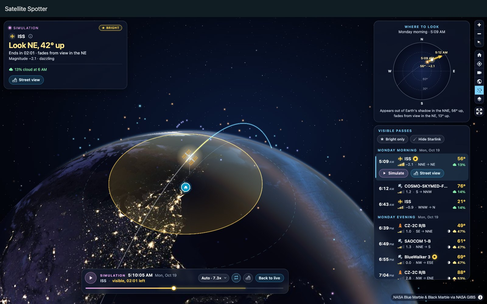
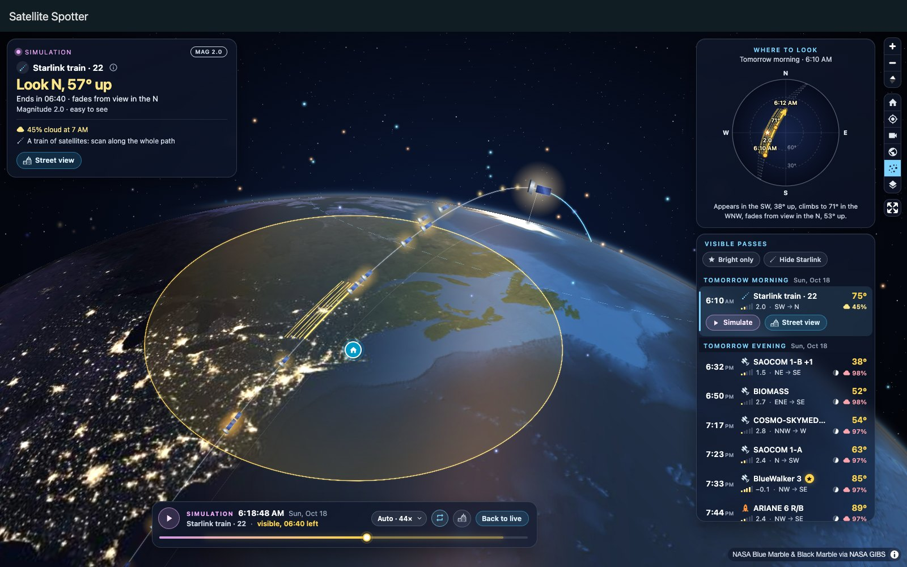
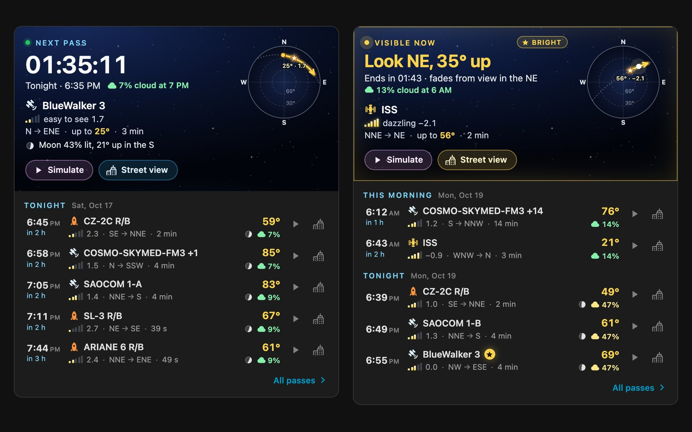
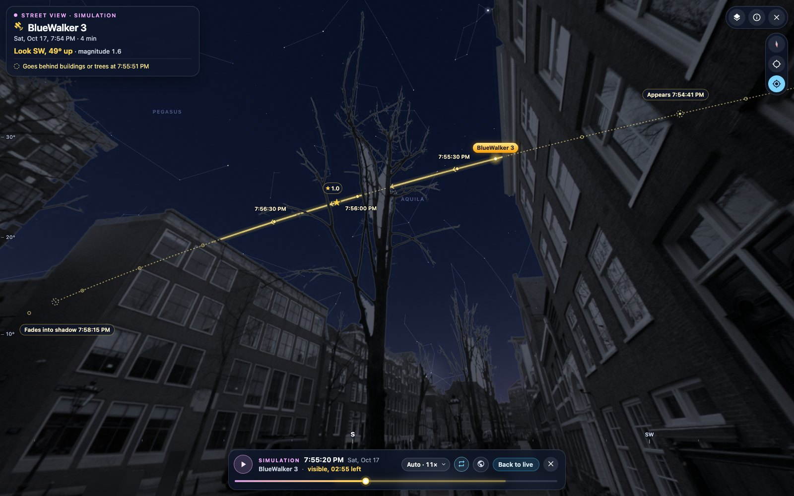
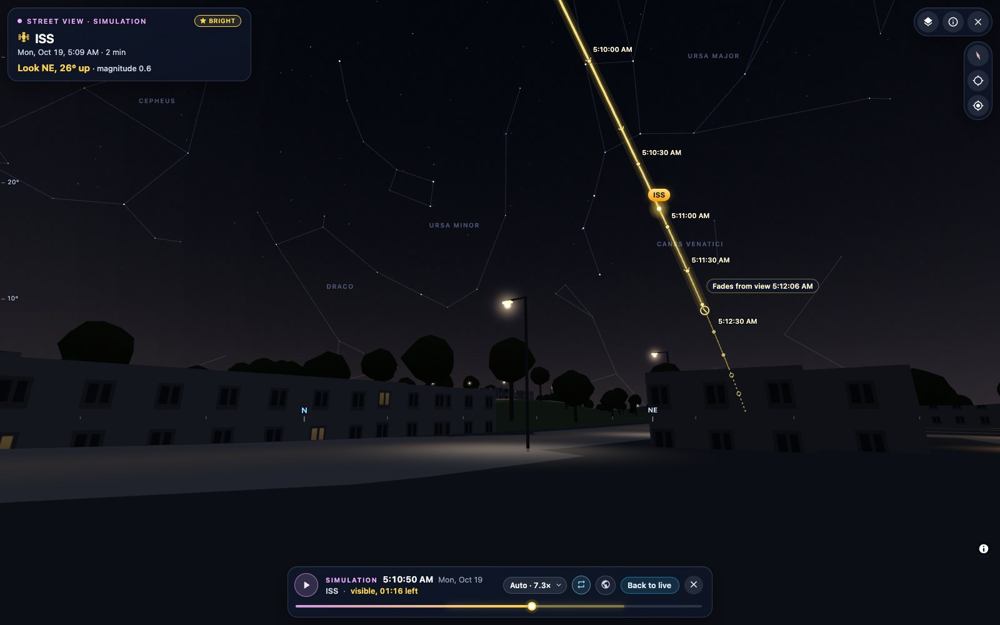
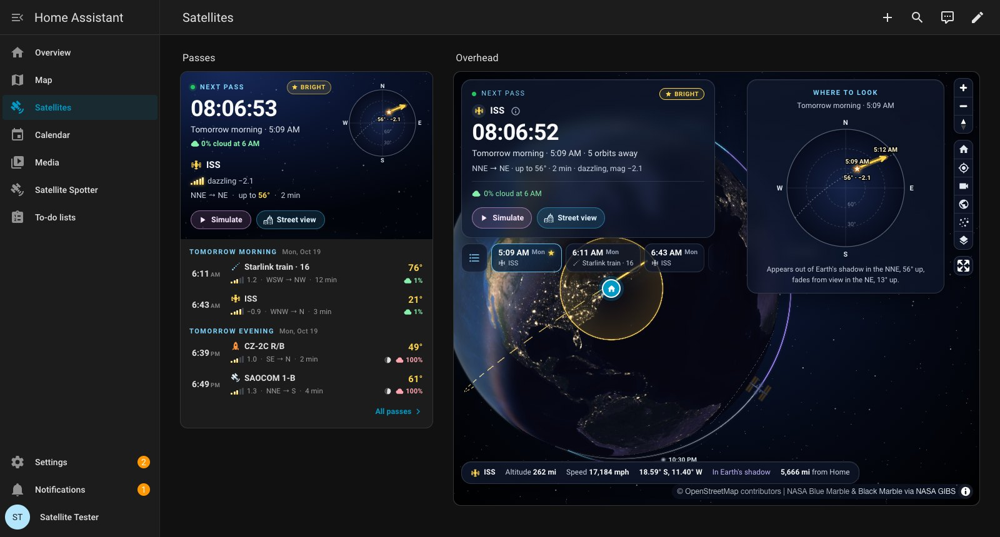

# Satellite Spotter for Home Assistant

[](https://hacs.xyz)
[](https://github.com/kedube/ha-satellite-spotter/releases)
[](https://github.com/kedube/ha-satellite-spotter/actions/workflows/ci.yml)

[](LICENSE)



Know when to step outside and look up. Satellite Spotter predicts when satellites will be
**visible to the naked eye** from your home, and shows you where to look: on a 3D globe, on a
sky chart and from your own street.

It follows about 970 objects, including the International Space Station, Tiangong, Hubble, spent
rocket stages and trains of new Starlinks. Everything is worked out on your Home Assistant, five
days ahead, for each location you add.

## Features

- **Passes:** when, where to look, how high, how bright and how cloudy, with a rating that says
  whether it is worth going outside. Satellites crossing together count as one pass.
- **Sensors, a calendar and an action** for automations, and a blueprint that notifies your phone
  before a pass, with a picture of its path across the sky.
- **A sidebar page** with the globe, pass simulations, a sky chart and the list of passes.
- **Street view:** the pass in a 360° photo of your street, darkened for the night, or in a 3D
  model of the neighbourhood, under the real stars. Buildings and trees hide the satellite where
  they really would.
- **Two dashboard cards:** the globe, and a lighter passes card that needs no 3D.
- **Nine languages:** English, Dutch, French, German, Italian, Polish, Brazilian Portuguese,
  Spanish and Swedish.

| Simulating a train of 22 Starlinks | The passes card |
|---|---|
|  |  |
| **Street view from a photo** | **Street view from the 3D model** |
|  |  |

Street photo: Panoramax Test-NL (Amsterdam), CC BY-SA 4.0, from Panoramax. That screenshot is
under the same licence.

Only interested in the space station? [ISS Tracker](https://github.com/kedube/ha-iss-tracker) shows
its live position and its passes up to 30 days ahead, and can run alongside this.

## Installation

You need Home Assistant 2026.2 or newer.

### HACS (recommended)

1. Add `https://github.com/kedube/ha-satellite-spotter` as a custom repository. From Home Assistant
   2026.11, HACS is built in as the Marketplace: go to **Settings → Marketplace → Add from link**,
   which asks you to connect GitHub the first time. Before 2026.11, open **HACS → ⋮ → Custom
   repositories** and choose the type **Integration**.
2. Open **Satellite Spotter** and select **Install**, or **Download** in HACS.
3. In HACS, restart Home Assistant. In the Marketplace, setup starts straight away.
4. [Set up the integration](#setup).

Or use this button to open Satellite Spotter on your Home Assistant, in the Marketplace or in HACS:

[](https://my.home-assistant.io/redirect/hacs_repository/?owner=kedube&repository=ha-satellite-spotter&category=integration)

### Updating

HACS and the Marketplace offer each new release as an update and show its release notes. Install the
update, restart Home Assistant, and reload any dashboards you have open.

### Manual installation

1. Download `satellite_spotter.zip` from the
   [latest release](https://github.com/kedube/ha-satellite-spotter/releases/latest).
2. Unzip it into a `satellite_spotter` folder inside the `custom_components` folder of your Home
   Assistant configuration directory, creating the folders if needed.
3. Restart Home Assistant.

Manual installs don't get update notifications. Repeat these steps to update.

### Removing

1. Go to **Settings → Devices & services → Satellite Spotter** and delete each location.
2. Take the cards off your dashboards.
3. Remove **Satellite Spotter** in HACS or the Marketplace. If you installed it manually, delete its
   `custom_components/satellite_spotter` folder instead.
4. Restart Home Assistant.

If the catalogue was downloaded within the last two hours, or CelesTrak has just refused a download,
its copy stays in `.storage/satellite_spotter.catalog`, so that adding a location back doesn't have to
ask CelesTrak again. It holds public orbital data and nothing about you. If you're removing the
integration for good, you can delete that file.

## Setup

Go to **Settings → Devices & services → Add integration → Satellite Spotter**. Name the location,
check it on the map and give its elevation; a rough value is fine. The name starts its entity ids:
**Home** gives `sensor.home_next_visible_pass`.

Use **Add location** for more places, such as a cabin; they share one catalogue download.
**Reconfigure** moves a location and keeps its entities.

## Options

Select **Configure** on a location.

| Option | Default | What it does |
|---|---|---|
| Brightness cutoff | 2.25 | Lists only passes at least this bright, from -1 to 4. Lower numbers are brighter: 2.25 is about the faintest you can find from a suburb, and 1 keeps the easy ones. Starlinks are listed 0.75 past this. |
| Cloud forecast | On | Adds a cloud forecast to each pass, from Open-Meteo unless you choose a weather entity. |
| Weather entity for clouds | None | Takes the clouds from this entity's hourly forecast, so Open-Meteo is not asked. The entity must give cloud coverage. |
| Advance notice | 15 min | **Visible pass soon** and **Bright pass soon** turn on this long before the brightest satellite of the pass appears. |
| Minimum height | 10° | A satellite counts only while it is at least this high, from 5° to 60°. Raise it if trees or buildings hide your horizon. |
| Follow a person or tracker | None | For travel: passes are worked out for wherever this person or tracker is, once more than 25 km away, and at most every half hour. |
| Show Satellite Spotter in the sidebar | On | Adds the page. The cards work either way. |
| Show the passes in the calendar | On | Adds the location's calendar. |
| Units | Automatic | Metric or imperial on the page and in the street view. |
| Photos from | Best available | Which service supplies street photos, or **No photos: the 3D model**. |
| Mapillary access token, Google Cloud API key | None | Add more street photos (see below). |

Street photos come from Panoramax with no key. Two services add more, though only administrators'
browsers receive their keys, so everyone else sees Panoramax's photos:

- **Mapillary** is free. Sign up at mapillary.com, then under **Dashboard → Developers** register
  an application and copy its **Client Token**.
- **Google Street View** needs a Google Cloud project with billing on and the **Map Tiles API**
  enabled, and Google charges beyond a free monthly allowance. Restrict the key to that API and to
  the addresses you open Home Assistant at.

## Entities

For a location named **Home**. In other languages, new entities take their ids from the translated
names.

| Entity | What it tells you |
|---|---|
| `sensor.home_next_visible_pass` | When the next visible pass starts, or the one under way, with its details below and `upcoming`, the next passes (up to 20) |
| `sensor.home_next_visible_pass_peak_elevation` | How high it climbs (90° is straight overhead) |
| `sensor.home_next_visible_pass_brightness` | Estimated magnitude (lower is brighter) |
| `sensor.home_next_visible_pass_duration` | How long it is visible |
| `sensor.home_next_visible_pass_cloud_cover` | The cloud forecast for it |
| `sensor.home_next_visible_pass_rating` | Whether it is worth going outside for: great, good, fair or poor |
| `sensor.home_next_visible_satellite_name` | The name of the satellite |
| `sensor.home_next_bright_pass` | When the next bright pass starts, or the one under way, with its details |
| `sensor.home_satellite_elevation` | That satellite's elevation in your sky right now, with `azimuth`, `direction`, `range_km` and `sunlit` |
| `sensor.home_visible_passes_next_24_hours` | How many passes are under way or start within a day |
| `device_tracker.home_satellite_position` | Disabled until you enable it: the point on Earth beneath that satellite, for map cards, with `satellite`, `catalog_number`, `altitude_km` and `sunlit` |
| `binary_sensor.home_satellite_visible_now` | On during a pass |
| `binary_sensor.home_visible_pass_soon` | On from the advance notice before the pass's brightest satellite appears until the pass ends |
| `binary_sensor.home_bright_pass_soon` | The same, for bright passes |
| `calendar.home_visible_passes` | Every pass for about five days, with where to look |
| `sensor.home_orbital_elements_epoch` | Diagnostic: the middle date of the catalogue's orbital elements, with `downloaded`, `age_days`, `catalog_size`, `stale` and `last_download_error` |

The sensors with a pass's details, and the binary sensors while they are on, carry `pass_id`,
`satellite`, `catalog_number`, `kind`, `about_url`, `satellite_count`, `satellites`, `duration_seconds`,
`magnitude`, `bright`, `rating`, `sun_up`, `cloud_cover`, `appears_from_shadow`,
`disappears_into_shadow` and `confidence`, and the time, `_direction`, `_azimuth` and `_elevation` of `start`, `peak` and `end`.
When several satellites cross together these describe the brightest, and the sensor's state is when
the first of them appears.

A pass's **rating** is great, good, fair or poor. It weighs how bright the pass looks against the sky at
that moment, so twilight and moonlight count against it, then how high it climbs, how long it lasts and
the forecast clouds. It is a rule of thumb. With clear skies, about one pass in eight rates great and
three in ten good.

There is no sensor for the next pass whether visible or not, as there is in
[ISS Tracker](https://github.com/kedube/ha-iss-tracker): of the catalogue's 970 or so satellites, about
a hundred are above 10° at any moment.

`sensor.home_satellite_elevation` and `device_tracker.home_satellite_position` are the entities that
change without a pass beginning or ending: every minute, and every 10 seconds during a pass. Their
fast-changing details are not recorded, apart from the tracker's latitude and longitude, which draw
its trail on map cards. To keep your database smaller still, exclude them from the
[recorder](https://www.home-assistant.io/integrations/recorder/). Both follow the satellite of the pass
under way or the next, so they jump when it changes. With both disabled, nothing is worked out for them.

## Notifications

[](https://my.home-assistant.io/redirect/blueprint_import/?blueprint_url=https%3A%2F%2Fgithub.com%2Fkedube%2Fha-satellite-spotter%2Fblob%2Fmain%2Fblueprints%2Fautomation%2Fsatellite_spotter%2Fnotify_satellite_pass.yaml)

The blueprint notifies your phone before each pass in a location's calendar. By default it covers
passes rated Good or better, ten minutes ahead, with a picture of the pass's path across the sky, and
skips skies more than 60% cloudy. It can also keep to some kinds of satellite or a name, and keep
quiet at night. Tapping the notification opens the pass in the street view.

> **ISS in 10 min**\
> Best view at 20:32:30: NW, 40° high, magnitude -2.5. First visible at 20:31:02 toward W, 21° high.
> Last visible at 20:34:55 toward NE, 10° high. Rating: Great. Cloud cover near the pass: 12%.

For an automation of your own, use a calendar trigger, which fires for every pass:

```yaml
triggers:
  - trigger: calendar
    event: start
    offset: "-0:15:0"
    entity_id: calendar.home_visible_passes
actions:
  - action: notify.mobile_app_your_phone
    data:
      title: "Pass in 15 minutes: {{ trigger.calendar_event.summary }}"
      message: "{{ trigger.calendar_event.description.split('\\n')[:-1] | join(' ') }}"
      data:
        # Opens the pass in the street view: url on iPhones, clickAction on Android.
        url: "/satellite-spotter?pass={{ trigger.calendar_event.uid }}&view=street"
        clickAction: "/satellite-spotter?pass={{ trigger.calendar_event.uid }}&view=street"
```

With several locations, add `&entry_id={{ config_entry_id('calendar.home_visible_passes') }}` to
the links.

## The action

`satellite_spotter.get_passes` lists a location's passes, soonest first, for scripts and voice
assistants. It can filter by `start`, `end`, `min_rating`, `max_cloud_cover`, `bright_only`, `kinds` and
`satellite`, or find one by `pass_id`:

```yaml
actions:
  - action: satellite_spotter.get_passes
    data:
      config_entry_id: "{{ config_entry_id('calendar.home_visible_passes') }}"
      end: "{{ now() + timedelta(hours=12) }}"
      min_rating: good
      kinds: [iss, tiangong]
    response_variable: found
  - action: notify.mobile_app_your_phone
    data:
      message: >-
        {{ found.passes[0].satellite }} at
        {{ as_timestamp(found.passes[0].start) | timestamp_custom('%H:%M') }}
        Nothing worth going out for tonight.
```

Each pass has the fields of the `upcoming` attribute, as well as `kind`, `catalog_number`,
`satellite_count`, `satellites`, `confidence` and `sky_chart`, a link to a picture of its path that works
for a day without signing in.

## Dashboard cards

Both are in the card picker, with visual editors.

- **Satellite globe** (`custom:satellite-spotter-card`): the page's globe, with the next pass and
  its countdown.
- **Satellite passes** (`custom:satellite-passes-card`): a countdown, a small sky chart and the
  next passes. It needs no 3D, so it suits wall tablets and old phones.



## How it works

1. **Catalogue.** Every 12 hours, once for all locations, the integration downloads orbital elements
   from CelesTrak (about 4.7 MB) and joins them with `brightness.csv`, a table that ships with it,
   mostly of magnitudes measured by the Mini-MegaTORTORA telescope. It holds objects that could reach
   magnitude 3 overhead. Starlinks are chosen by height instead: those below 350 km, which are new
   ones still climbing and old ones coming down.
2. **Position.** SGP4 places each satellite once a minute for five days, then second by second
   around anything that might be visible.
3. **Brightness.** Each satellite's standard magnitude, which is for 1,000 km and half lit by the Sun,
   is adjusted for its distance, how much of it is lit as you see it, and the air in the way, which
   depends on your elevation. Starlinks use published models of their own.
4. **Visibility.** A satellite counts while it is at least your **Minimum height** up, 10° unless you
   change it, lit by the Sun, brighter than your **Brightness cutoff**, and bright enough for the sky at
   that moment.
5. **Passes.** Satellites that overlap or follow within a minute make one pass, named after the
   brightest, and fewer than five Starlinks together are left out. More than five show as a train. A
   pass is **bright** when it beats magnitude 0.5, and the sky's limit by 3 magnitudes, after sunset.

Passes are searched for again with each new catalogue, as they depend on the orbits, and the clouds
are refreshed every hour. In between nothing polls: entities change at the moments that matter.

### How far to trust it

- **Geometry** matches Skyfield with JPL's DE421 to within 0.005° on the sky and 0.04 km in
  distance, and the Sun to within 0.01°.
- **Brightness values** are mostly measured. Against what people reported in SCORE for 119 objects,
  81% come within a magnitude, though most of those reports are of satellites too faint for the
  naked eye.
- **The list differs from See A Satellite Tonight's**, which is a comparison here, not the truth. Over
  five days at eight cities it found 249 of the site's 330 passes outside Starlink trains, and 62
  others. Of the site's 31 bright passes it listed 29, and labelled 18 of them bright.
- **Starlink trains** matched in the next two days (2 of 2), but only 10 of 17 over five days,
  because their orbits change quickly.
- **Brightness is an estimate.** A satellite can look a magnitude or more brighter or fainter than
  predicted, and rocket stages flash as they tumble. The Moon and light pollution don't change what is
  listed, though the rating allows for the Moon.
- **Orbits drift** by seconds to minutes as elements age. The page marks a pass **Medium confidence**
  when its elements are more than 3 days from the pass, and **Low confidence** beyond a week. Passes
  are predicted 5 days ahead, so those more than about 2 days away usually show Medium even with
  fresh elements.

## Privacy

Your coordinates and keys stay out of Home Assistant's log and diagnostics, and so does what you call a
location. Home Assistant makes the first three requests below and fetches the place names. Your browser
loads the rest while the page, a card or the street view is open.

| What | Goes to | What it learns |
|---|---|---|
| Catalogue download | CelesTrak | Nothing about where you are |
| Cloud forecast (optional) | Open-Meteo, unless you choose a weather entity | Each location's coordinates to about a kilometre, every hour |
| Checking a new key, once, in the options | Google or Mapillary | The key. Google also gets Home Assistant's language and country. Not your location |
| Globe imagery | NASA GIBS and EOX, or Esri if you choose it | The area on screen |
| Place names and street map | OpenStreetMap, through Home Assistant | The area on screen |
| 3D model | OpenFreeMap and Amazon Web Services, plus Esri for aerial photos | The area around your home |
| Street photos | Panoramax, plus Mapillary and Google if you add keys, and whichever servers they keep their pictures on | Your home's position to about 10 m, which photo is shown and any key. Google also sees your Home Assistant's address, language and country |

Anyone with a login to your Home Assistant can read every location's coordinates, as the page draws them.
That goes for wherever a location **follows** someone too, and Open-Meteo learns roughly where they are
unless you use a weather entity. Only administrators' browsers receive the keys.

## Troubleshooting

- **No passes.** Satellites show for a while after dusk and before dawn, when the Sun lights them but
  your sky is dark. Near midsummer, far from the equator, the sky barely darkens, so few are listed.
  A **Brightness cutoff** below the default of 2.25, or a high **Minimum height**, also hides passes.
- **No clouds on the passes.** A weather entity needs an hourly forecast with cloud coverage, and many
  have none or only a day or two ahead.
- **"Satellite predictions are paused" in Repairs.** The orbital elements are over two weeks old and
  no fresh catalogue could be downloaded. Check that Home Assistant can reach `celestrak.org`.
  Predictions resume by themselves.
- **Setup or the page says CelesTrak refused a download.** CelesTrak allows one download of the same
  data every two hours, and anything else on your connection downloading it can use that up. Nothing
  needs doing: the integration waits two hours, then tries again by itself. Deleting and re-adding a
  location doesn't shorten the wait.
- **The page or a card asks for WebGL 2.** Turn on hardware acceleration in your browser. The passes
  card needs no WebGL.
- **The street view shows the 3D model, or only the sky.** There is no 360° photo within 200 m, a
  service did not answer, or the device is too slow for the model. **Layers** and the title card say
  which.
- **The page is missing.** Every location has it switched off, or another dashboard already uses
  `/satellite-spotter`.
- **The old version still shows after an update.** Reload the page, or restart the Companion app.

## Development

```bash
python3.14 -m venv .venv && . .venv/bin/activate
pip install -r requirements_test.txt ruff==0.17.0 mypy==2.4.0
pytest
node --test "tests/js/*.test.mjs"
node tests/browser/run.mjs  # In real Chrome, with WebGL: nothing leaves the machine.
ruff check . && ruff format --check . && mypy
```

The tests need no network. The scripts in `scripts/` build the generated files
(`make_brightness_table.py`, `make_sky_data.py`, `make_brand.py`), cross-check the geometry
(`validate_against_skyfield.py`) and publish releases (`release.py`). Each explains itself at the
top.

A workflow proposes an updated `brightness.csv` each week: see
[Updating the brightness table](docs/updating-brightness.md).

To add a language, copy a JSON file in both `translations/` folders, translate the values, keep each
`{placeholder}`, and add the code to `LANGUAGES` in `frontend/sat-i18n.js`. The tests check the rest.

## Credits and references

Satellite Spotter is licensed under the GNU GPL v3; see `LICENSE`. It began as a fork of Willem Vooijs's
[See A Satellite Tonight integration](https://github.com/wildekek/ha-see-a-satellite) and
[see-a-satellite](https://github.com/wildekek/see-a-satellite) library, both under the MIT licence, and
has been largely rewritten since. Code that came from them remains under the notice in
[`LICENSES/MIT-see-a-satellite.txt`](LICENSES/MIT-see-a-satellite.txt).

### The predictions

- **How bright a satellite is:** Karpov et al. 2016,
  [Massive photometry of low-altitude artificial satellites on Mini-Mega-TORTORA](https://ui.adsabs.harvard.edu/abs/2016RMxAC..48..112K/abstract),
  Revista Mexicana de Astronomía y Astrofísica (Serie de Conferencias) Vol. 48, pp. 112-113, for both
  the values and the formula's definition. The telescope is described by Beskin et al. 2017,
  [Wide-field optical monitoring with Mini-MegaTORTORA (MMT-9) multichannel high temporal resolution telescope](https://ui.adsabs.harvard.edu/abs/2017AstBu..72...81B/abstract),
  Astrophysical Bulletin, Volume 72, Issue 1, pp. 81-92.
- **What the sky lets you see:** Weaver 1947,
  [The Visibility of Stars Without Optical Aid](https://doi.org/10.1086/125956), PASP 59, 232. This
  code departs from its curve on purpose: -4 rather than about -3.2 in full daylight, and stopping
  at 4 rather than 6.
- **Where the Sun is, and how the Earth turns:** Meeus 1998, *Astronomical Algorithms*, ch. 25;
  Aoki et al. 1982 for sidereal time, in the form of Vallado et al. 2006.
- **How much the air dims a satellite:** Green 1992,
  [Magnitude Corrections for Atmospheric Extinction](http://www.icq.eps.harvard.edu/ICQExtinct.html),
  International Comet Quarterly 14, 55.
- **Starlink brightness:** Mallama et al. 2025,
  [Characterization of Starlink Direct-to-Cell Satellites In Brightness Mitigation Mode](https://arxiv.org/abs/2502.03651);
  Mallama et al. 2024,
  [The Brightness of Starlink Mini Satellites During Orbit-Raising](https://arxiv.org/abs/2405.12007).
- **Thresholds with no published source:** the horizon, the height sunlight must clear, the margin
  over the sky's limit, the departures from Weaver's curve and which passes count as one are James
  Darpinian's choices for
  [See A Satellite Tonight](https://james.darpinian.com/satellites/), which does not make or support
  this integration.

### Data

| Used for | Source | Licence or terms |
|---|---|---|
| Orbits | [CelesTrak](https://celestrak.org), from US Space Force data on Space-Track and, for Starlinks, SpaceX's ephemerides | |
| Brightness (`brightness.csv` credits each value) | [Mini-MegaTORTORA](http://mmt.favor2.info/satellites), then [Mike McCants's list](https://www.mmccants.org/), [SCORE](https://score.cps.iau.org) (IAU CPS) and [Stellarium](https://stellarium.org), and [Heavens-Above](https://www.heavens-above.com/satinfo.aspx?satid=48274) for Tiangong | MMT: used with its team's permission, citing the papers above. SCORE: CC BY 4.0. Stellarium: GPL |
| Checking those values | [GCAT](https://planet4589.org/space/gcat) by Jonathan McDowell; Mallama & Cole 2025, [arXiv:2507.00107](https://arxiv.org/abs/2507.00107) | GCAT: CC BY 4.0 |
| Cloud cover | [Open-Meteo](https://open-meteo.com) | CC BY 4.0, free for non-commercial use |
| Globe imagery | NASA Blue Marble and Black Marble via GIBS; [Sentinel-2 cloudless](https://s2maps.eu) by EOX IT Services (contains modified Copernicus Sentinel data 2025); Esri World Imagery (Esri, Vantor, Earthstar Geographics and the GIS User Community) | NASA: free with credit. EOX: CC BY-NC-SA 4.0, personal and non-commercial use. Esri: its terms of use |
| Maps and terrain | © OpenStreetMap contributors, via [OpenFreeMap](https://openfreemap.org) and Home Assistant; [Mapzen Terrain Tiles](https://github.com/tilezen/joerd/blob/master/docs/attribution.md) on AWS Open Data | OpenStreetMap: ODbL |
| Street photos | [Panoramax](https://panoramax.fr), Mapillary, Google Street View | Panoramax: each photographer's licence, shown with the photo. Mapillary: CC BY-SA 4.0. Google: © Google, its terms |
| Stars and constellations | Yale Bright Star Catalogue, 5th ed. (Hoffleit & Warren 1991; VizieR V/50, CDS); IAU star names; [d3-celestial](https://github.com/ofrohn/d3-celestial) © 2015 Olaf Frohn, after the IAU and Sky & Telescope charts | IAU names: CC BY 4.0. d3-celestial: BSD-3-Clause. Charts: CC BY 3.0 |
| Compass correction | World Magnetic Model WMM2025, NOAA NCEI and the British Geological Survey | Public domain |

### The sky and the software

- **Sun, Moon and planets in the drawn sky:** the Astronomical Almanac (Sun), Meeus 1998, *Astronomical Algorithms*
  (Moon), JPL's approximate planetary elements, Mallama & Hilton 2018 (planet magnitudes) and
  Neuhäuser et al. 2022 (planet colours).
- **The Moon in a pass's rating:** the Astronomical Almanac's low-precision formulae.
- **Drawing the sky:** Lieske et al. 1977 (precession), Sæmundsson 1986 (refraction), Kasten &
  Young 1989 (air mass) and Ballesteros 2012 (star colours).
- **Software:** [`sgp4`](https://pypi.org/project/sgp4/) by Brandon Rhodes (MIT),
  [MapLibre GL JS](https://maplibre.org) (BSD-3-Clause), and the
  [Space Grotesk](https://github.com/floriankarsten/space-grotesk) typeface in the logo (SIL Open
  Font License 1.1).
